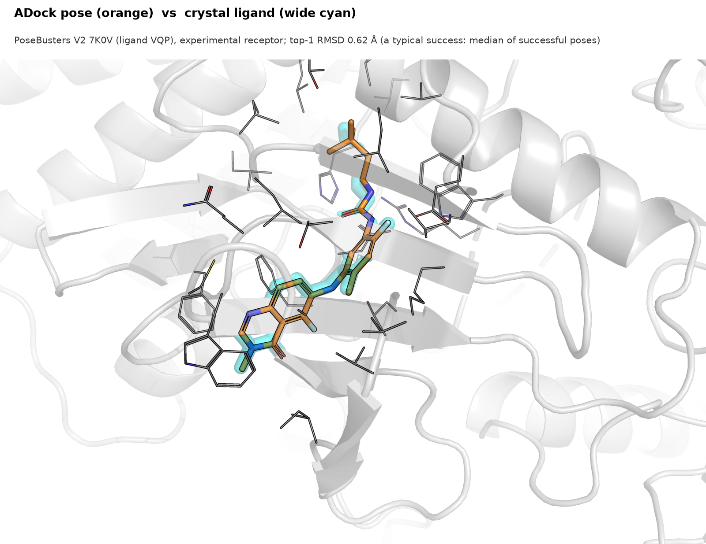

# ADock

> **Note: this is the output of an AI-agent experiment.** The repository comes from an experiment that asked whether AI
> agents can run a bioinformatics research project on their own within 24 hours. A PI agent (Claude Opus 5.5) directed
> Opus 5.5 and Sonnet 5.5 sub-agents in Claude Code. The original task prompt is in [`PROMPT.md`](PROMPT.md) (verbatim).
> **Humans did not write the code.** Independent agents checked the results; human experts did not.

*A typical ADock result: the predicted pose (orange) sits on the crystal ligand (wide cyan) in the experimental
receptor of PDB 7K0V from the PoseBusters V2 test set (top-1 RMSD 0.62 Å). The example was chosen by a fixed rule,
not by eye: it is the median-RMSD success among drug-sized ligands
(`scripts/render_docked_example.py`, v3 preset, seed 0). On AlphaFold receptors such results are much rarer (see below).*

**Short reads:** [2-page briefing](docs/summary/briefing.pdf) · [4-page technical report](docs/summary/technical_report.pdf) ·
[graphical abstract](docs/summary/graphical_abstract.png). Markdown sources and figure scripts are in
[`docs/summary/`](docs/summary/).

ADock is a protein–ligand docking engine for GPU (CUDA through cupy NVRTC) and multi-core CPU. It uses Vina-family
scoring, plus an optional fitted scoring function with 18 interpretable weights. It also has a template-first hybrid
mode for AlphaFold (AF) receptors. In the pre-registered test evaluation (seed 0, pocket given; [`docs/REPORT.md`](docs/REPORT.md) §1, §6):

- **Speed.** Per complex, ADock is **46–54× faster than GNINA** and **12–14× faster than Uni-Dock** (median, warm single complex, shared node).
- **PoseBusters V2 (holo, n=285).** v2_fitted reaches **58.6 %** success. gnina without CNN reaches 59.3 % and GNINA with CNN rescoring 67.0 %.
- **Pre-registered claims.** None of the confirmatory claims (C1–C3) passed after Holm correction.
- **AF receptors (Runs N' Poses post-2023, AFDB v4, n=178).** ADock reaches **11.2 %** against GNINA's **18.0 %**.
  The exploratory template-first hybrid reaches **23.6 %** at tier T1 against 18.0 % (p 0.077). With stricter
  template tiers it does not beat GNINA (T3 11.8 %).

Success means a top-1 symmetry-corrected heavy-atom RMSD ≤ 2 Å with the pocket given. Limitations, negative results
and deviations from the pre-registration are in `docs/REPORT.md` §5, §7 and `docs/RESEARCH_TREE.md`.

## Install

You need Linux, conda (or mamba) and an NVIDIA GPU for the CUDA engine. The search kernels are compiled at run time by
cupy NVRTC. On Blackwell (sm_120) cards that needs **CUDA ≥ 12.8** builds, which the env pins: `cuda-version=12.9` and
torch 2.8.0+cu128. Development used one RTX PRO 6000 Blackwell (driver 580).

    ENV_STORE=/tmp/adock/envs CONDA_PKGS_DIRS=/tmp/adock/pkgs MAMBA=conda bash scripts/install_env_dock.sh --from-yml
    export PATH=/tmp/adock/envs/dock/bin:$PATH
    pip install -e .            # or: export PYTHONPATH=$PWD/src
    python scripts/check_env_dock.py

- `envs/dock.yml` describes the engine env: conda-forge packages plus pip packages (torch cu128, cupy-cuda12x).
  `envs/data.yml` (`scripts/install_env_data.sh`) is only needed for the data scripts (`make_splits.py`, `prepare_records.py`).
- **CPU build.** `adock.cpukernel` compiles the same kernel source with `g++ -O3 -fopenmp` the first time it is used.
  Set `ADOCK_CXX` to choose the compiler and `ADOCK_CPU_CACHE` (default `/tmp/adock/cpukernel`) for the build cache.
  The fitted preset has no CPU path, because it uses the GPU grid builder (REPORT §6.5).
- **Site paths** are set by environment variables. Defaults are in `src/adock/config.py` (`ENV_DEFAULTS`):
  `ADOCK_WORK` (scratch, default `/tmp/adock`), `ADOCK_PDB_MIRROR` (a local wwPDB rsync mirror, default `data/pdb_mirror`),
  `ADOCK_AFDB_DIR`, `ADOCK_VINAGPU_DIR`. Config strings such as `"${ADOCK_PDB_MIRROR}"` are expanded at load time.
- `pip install -e .` installs only the `adock` package and an `adock-dock` entry point. It deliberately installs no
  dependencies, so the CUDA builds from the env are not replaced.

## Quickstart

**Single docking** with the final holo method (v2_fitted):

    python -m adock.dock --receptor receptor.pdb --ligand ligand.sdf --box box.json --out poses.sdf \
        --mode v2_fitted --seed 0

- `box.json` holds `{"center": [x, y, z], "size": [sx, sy, sz]}`. Record boxes produced by `prepare_records.py` hold
  several boxes; choose one with `--box_key`.
- The ligand SDF is the input structure (with hydrogens). Up to 9 poses are written, and the top affinity is printed.
- Other presets in `config/adock.json` are `v2_default`, `v2_fast` and `v2_accurate`.
- Not every preset in that file works in this release. The presets from negative arms (`v2_rerank`, `v2_consensus*`)
  and `--af-mode` values other than `none` need modules that are not included here (see "Not included").

**Batch docking** of a prepared record set (writes a per-complex CSV with RMSD and success):

    python scripts/run_adock.py --set val_astex --mode v2_fitted --seed 0 --csv_dir out/

**Template-first AF hybrid (C5).** First build the date-safe template DB once from a local wwPDB mirror. This needs
MMseqs2 (`scripts/install_mmseqs.sh`) and SIFTS (`scripts/data_fetch_sifts.sh`); `afhybrid_setup.sh` runs both if they
are missing. Then run:

    ADOCK_PDB_MIRROR=/path/to/rsyncPDB bash scripts/afhybrid_setup.sh
    python scripts/run_afhybrid.py --split val_af_post2023 --receptor af --tier all --seed 0 --out hybrid.csv

Records are read from `--records` (default `/tmp/adock/data/records/<set>/<id>/`) and are built by
`scripts/prepare_records.py`. Every script refuses `test_*` sets unless `ADOCK_FINAL_EVAL=1` (`src/adock/guard.py`).

## Repository layout

| path | content |
|---|---|
| `src/adock/` | engine: typing, scoring, grids, CUDA/CPU search kernels (`mckernel`, `cpukernel`), `dock` CLI, `rmsd`, `screen` (batched GPU), `guard` (test-set lock); `fit/` fitted scoring; `template/` template search and hybrid; `afmode/structure.py` (pocket-key helper used by the hybrid) |
| `config/` | `adock.json` (presets), `adock_fitted.json` (18-weight fitted SF), `adock_af_fitted.json`, `template.json`, `records.yaml`, `preregistration.yaml` (pre-registration + amendments A1–A7), `final_frozen.yaml` (freeze record), `smoke_test.json` |
| `scripts/` | docking/hybrid runners, env install, data/split provenance, final statistics (see below) |
| `tests/` | unit and control tests (engine, CPU/GPU parity, Vina parity, fitted terms, template, hybrid, final stats) |
| `envs/` | conda env specs |
| `predictions/` | all test-set outcomes, statistics, split IDs and available pose files ([`predictions/README.md`](predictions/README.md)) |
| `results/splits/` | locked non-test splits (fit/val) as written by `scripts/make_splits.py` (test splits: `predictions/splits/`) |
| `docs/` | final report, research tree, design/pre-registration, literature, lessons, agent reports and reviews ([`docs/README.md`](docs/README.md)) |
| `DATA.md` | source, version, checksum and licence of every dataset, weight file and baseline binary |
| `docs/summary/` | 2-page briefing, 4-page technical report, graphical abstract, figures and a GitHub social-preview image; rebuilt by `scripts/make_summary_figures.py`, `scripts/render_docked_example.py` and `scripts/render_summary_pdf.py` |

Scripts:
- Docking: `run_adock.py` (batch), `run_afhybrid.py` (hybrid).
- Template DB: `afhybrid_setup.sh`, `template_build_db.py`.
- Environments and tools: `install_env_dock.sh`, `install_env_data.sh`, `check_env_dock.py`, `install_mmseqs.sh`.
- Data and splits (provenance): `data_fetch_*`, `make_splits.py`, `make_test_rnp_dimer_subsample.py`, `prepare_records.py`, `test_access.py`.
- Statistics: `final_stats.py`, `final_tables.py`, `c9_similarity_strata.py` (uses `data_runsnposes_summary.py` for the similarity bins).
- Test fixtures: `smoke_test_baselines.py --prepare-only` (1STP), `make_dev_records.py`.
- Pose export: `pack_pose_arrays.py`.

## Reproducing the tables from the included CSVs

    mkdir -p /tmp/adock/stats/out && tar -xzf predictions/raw.tar.gz -C /tmp/adock/stats
    cp predictions/timing.csv /tmp/adock/stats/out/
    ADOCK_FINAL_EVAL=1 python scripts/final_stats.py --out /tmp/adock/stats/out --raw /tmp/adock/stats/raw
    python scripts/final_tables.py --out /tmp/adock/stats/out
    python scripts/c9_similarity_strata.py /tmp/adock/stats/c9_strata.csv

`final_stats.py` reads only the per-run CSVs, the split files and the record indexes in `predictions/`.
`ADOCK_FINAL_EVAL=1` is its test-mode switch; with it, the script reads result CSVs, not structures.

*Checked on 2026-10-27 by the release agent.*
- `claims.csv`, `holm.csv`, `secondary.csv`, `c5.csv`, `c4_logit.csv`, `c1_gap_closed.csv`, `c2_timing.csv`,
  `success_summary.csv` and `c9/similarity_strata.csv` were regenerated byte-identical to the files in `predictions/`.
- `tables.md` and `provenance.json` differ only by a config-hash warning. It appears because `config/template.json`
  was edited for this release: absolute data paths were replaced by `${ADOCK_*}` variables, so its sha256 no longer
  matches `config/final_frozen.yaml`.
- The C7/C8 (`predictions/v3/`) and C9 tables come from scripts that are not in this release (see "Not included").

Re-running the full test evaluation needs the sealed test records, the baseline binaries and `scripts/final_eval.sh`.
These are not included. Rebuilding the data from public sources is described in DATA.md.

## Data sources

All datasets are public: PoseBusters V1/V2 and Astex, PoseBench, DockGen, Runs N' Poses, PLINDER, wwPDB, AFDB and
SIFTS. Versions, URLs, checksums, licences and fetch scripts are listed in [`DATA.md`](DATA.md). The locked split
files (with sha256 in `results/splits/sha256.tsv`) are included. No receptor structures, AFDB/PDB structure files or
model weights are included.

## Verification status (release agent, 2026-10-27, one GPU node)

- `pytest -q` in this repo passed: **100 passed, 9 skipped**. It ran with the dock env, an RTX PRO 6000 GPU and
  `ADOCK_PDB_MIRROR` set, and the 1STP fixture was generated with `scripts/smoke_test_baselines.py --prepare-only`.
  The 9 skips need Astex dev records (`scripts/make_dev_records.py`), which were not available.
- **Quickstart single docking, val_astex 1G9V_RQ3** (holo, v2_fitted, seed 0): it ran in about 3 s. Top-1 RMSD was
  **17.4 Å** (a failure); the best of 9 poses was 1.42 Å.
- **Quickstart single docking, 1STP smoke example** (streptavidin/biotin): top-1 RMSD **0.72 Å**.
- **Hybrid quickstart** (`run_afhybrid.py`, 5 val_af_post2023 IDs, 4 docked): it ran end to end. This only shows that
  the code runs; it is not an accuracy check.
- `pip install -e .` was tested in a throwaway venv, and `import adock, adock.dock, adock.template` worked.
- The env install script was **not** re-run for this release; an env that already existed was used.

## Not included

The full research workspace is not included. Left out:
- the negative arms and their code (`afmode` except `structure.py`, `consensus`, `induced`, `rerank`, `pocketxfer`);
- co-folding (Boltz-2, OpenFold3, BioEmu) setup and drivers;
- baseline drivers and sealed-test runners (`final_eval.sh`, `score_sealed.py`, `run_baselines_*`);
- fit-reproduction scripts (`fit_*`), the v3/C8/C9 test drivers, benchmarks, and all val sweep results.

Their outcomes are documented in `docs/REPORT.md`, `docs/RESEARCH_TREE.md` and `docs/reports/`, which may still
reference these files.

## License

License: to be chosen by the authors before publication (code reimplements AutoDock Vina scoring, Apache-2.0).
