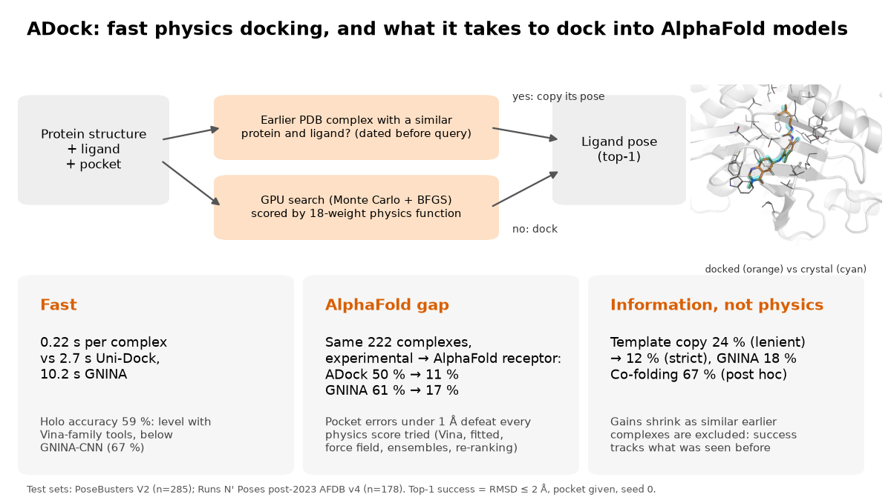
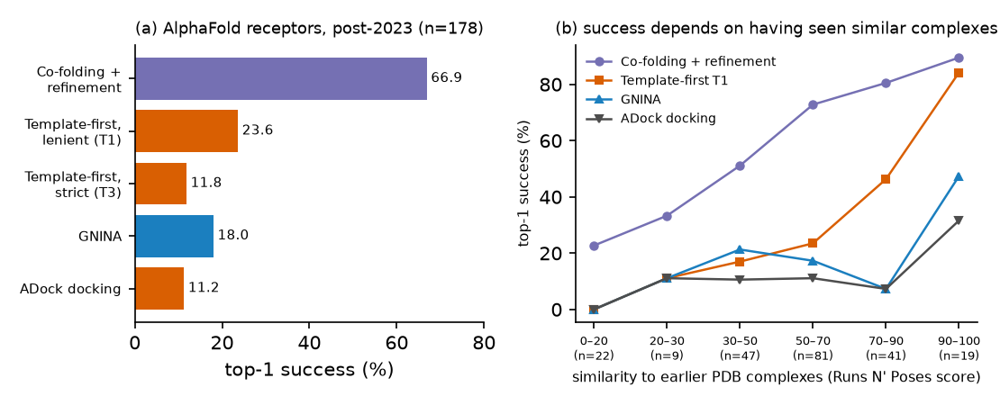

# ADock — briefing

*October 2026. AI-agent research project (24 h). Checked by independent agents, not yet by human experts.
Details: `technical_report.pdf` (4 pages) and `docs/REPORT.md` (full record).*

## What was built

**ADock is a fast docking program.** Given a protein structure, a small molecule and the location of the binding
pocket, it predicts the 3D pose in which the molecule binds.
- **On experimental structures** it runs a GPU version of the classical AutoDock Vina search, scored with a refitted,
  interpretable physics-style function.
- **On AlphaFold-predicted structures** it first checks whether an earlier PDB complex of a similar protein and ligand
  exists. If one does, ADock copies that ligand's pose; otherwise it docks.

## How it was tested

- **Success measure.** A prediction counts as correct if the top-ranked pose lies within 2 Å (RMSD) of the crystal
  pose. The pocket is given to every method in the same way.
- **Test sets.** These were held out until one final run:
  - **PoseBusters V2:** 285 complexes with experimental receptors.
  - **Runs N' Poses:** 222 complexes released after mid-2023, docked into both the experimental structure and the
    AlphaFold model (178 have the older AlphaFold database model used for the main AlphaFold claim).
- **Comparison tools:** AutoDock Vina, smina, Uni-Dock (GPU Vina) and GNINA, which adds neural-network rescoring and
  is the strongest open tool.
- **Pre-registration.** Three main claims and their statistical tests were written down before the test data were
  opened.

## Main findings

1. **Fast, with standard accuracy.**
   - ADock takes 0.2 s per complex, against 2.7 s for Uni-Dock and 10 s for GNINA.
   - On experimental structures it is as accurate as the classical tools: 59 % vs Vina 55 % and GNINA without its
     network 59 %.
   - It stays below GNINA with neural-network rescoring, at 67 %.
2. **AlphaFold models break physics-based docking.**
   - On the same 222 complexes, ADock drops from 50 % on experimental to 11 % on AlphaFold receptors; GNINA drops
     from 61 % to 17 %.
   - The AlphaFold pockets are close to the real ones (within about half an ångström), but these small errors mislead
     every physics score we tried. Seven physics-side fixes gave no real gain (one apparent gain was a benchmark artefact). These were softer
     receptors, side-chain rebuilding, structure ensembles, a full force field, an AlphaFold-specific score, consensus
     scoring and re-ranking.
3. **Information from earlier complexes helps; physics does not.**
   - Copying the pose from an earlier similar complex lifts AlphaFold success to 24 %, above GNINA's 18 %, but not
     significantly at the pre-specified level (p 0.08).
   - When close relatives are excluded, the gain disappears (12 %).
   - A co-folding model (Boltz-2), tried after the test, reached 67 %. Its success, however, falls to 23 % on the
     targets least similar to earlier PDB complexes.
   - Success on AlphaFold receptors therefore mostly reflects what has been seen before.
4. **None of the three pre-registered main claims passed.**
   - ADock is not better than GNINA on AlphaFold receptors.
   - It is faster but less accurate than GNINA.
   - Its non-inferiority to the best physics tool was not significant after correction for testing three claims.

*Success on AlphaFold receptors (post-2023 complexes). Left: all methods. Right: the same methods split by how similar
each test complex is to complexes in the PDB before it. Co-folding was added after the test and is exploratory.*

## What this means

- **Experimental or high-confidence structures.** ADock is a practical choice for large-scale screening where speed
  matters: about 66 pockets per second per GPU node, or roughly 4 node-hours per million pockets (a projection).
  Where per-complex accuracy matters most, GNINA is better.
- **AlphaFold models of proteins with no similar solved complex.** No method tested here docks reliably (about 10–20 %
  success). Closing this gap needs pocket models accurate to well below 1 Å, or a score that tolerates such errors.
  Neither exists yet.
- **Research practice.** In nearly every experiment, gains seen during method selection shrank or vanished when
  checked on held-back data. Pre-registration and a held-out test changed what could be claimed.

## Main limitations

- The binding pocket must be known in advance.
- Timings come from a node shared with other users, so treat them as upper bounds.
- Template thresholds, the improved "v3" settings and co-folding were chosen or added after seeing data, so those
  results are exploratory.
- The project was run by AI agents in 24 hours. Humans have not yet reviewed the code or results.
