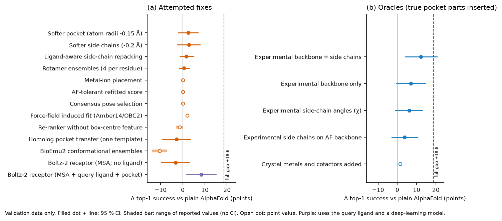

# ADock — briefing

*October 2026. AI-agent research project (24 h). Checked by independent agents, not yet by human experts.
Details: `technical_report.pdf` (4 pages) and `docs/REPORT.md` (full record).*

## What was built

**ADock is a fast docking program.** Given a protein structure, a small molecule and the location of the binding
pocket, it predicts the 3D pose in which the molecule binds.
- **How it works:** a GPU version of the classical AutoDock Vina search, scored with a refitted, interpretable
  physics-style function.
- **What we then asked:** why does docking fail when the protein structure comes from AlphaFold instead of an
  experiment?

## How it was tested

- **Success measure.** A prediction counts as correct if the top-ranked pose lies within 2 Å (RMSD) of the crystal
  pose. The pocket is given to every method in the same way.
- **Test sets,** held out until one final run:
  - **PoseBusters V2:** 285 complexes with experimental receptors.
  - **Runs N' Poses:** 222 complexes released after mid-2023, docked both into the experimental structure and into
    the AlphaFold model.
- **Comparison tools:** AutoDock Vina, smina, Uni-Dock (GPU Vina) and GNINA, which adds neural-network rescoring and
  is the strongest open tool.
- **Diagnosis data.** The causes of the AlphaFold gap were studied only on a separate validation set of 125
  post-2023 complexes. One half was used for choices and the other to confirm them.
- **Pre-registration.** Three main claims and their tests were written down before the test data were opened.

## Main findings

1. **Fast, with standard accuracy.**
   - ADock takes 0.2 s per complex, against 2.7 s for Uni-Dock and 10 s for GNINA.
   - On experimental structures it is as accurate as the classical tools: 59 %, against 55 % for Vina and 59 % for
     GNINA without its network.
   - It stays below GNINA with neural-network rescoring (67 %).
2. **AlphaFold models break physics-based docking.** On the same 222 complexes, ADock drops from 50 % on
   experimental to 11 % on AlphaFold receptors, and GNINA from 61 % to 17 %. This happens although the AlphaFold
   pockets are close to the real ones (backbone within about half an ångström).
3. **Nothing we tried closes the gap.**
   - **Thirteen fixes:** softer receptors, side-chain rebuilding, rotamer and BioEmu2 structure ensembles, metal
     placement, a score refitted for AlphaFold, consensus scoring, re-ranking, a full molecular-mechanics force field,
     pocket transfer from related structures, and co-folded receptors.
   - **Results:** each gave between −14 and +3 points, except co-folding with the actual ligand (+8). That still
     closes less than half the gap and uses a deep-learning model and the ligand itself.
4. **The cause is sub-ångström pocket geometry.**
   - Replacing the AlphaFold pocket by the true one recovers 12 points; true side chains or metals alone do not
     help significantly.
   - In AlphaFold pockets the correct pose often scores worse than wrong poses, even under a full force field.
     Better searching therefore cannot help.
5. **None of the three pre-registered main claims passed.**
   - ADock is not better than GNINA on AlphaFold receptors.
   - It is faster but less accurate than GNINA.
   - Its non-inferiority to the best physics tool was not significant after correction for three claims.

*What closes the AlphaFold gap (validation data)? Left: attempted fixes. Right: oracles that insert parts of the true
pocket. The dashed line marks the full gap.*

## What this means

- **Experimental or high-confidence structures.** ADock suits large-scale screening where speed matters: about 66
  pockets per second per GPU node, or roughly 4 node-hours per million pockets (a projection). Where per-complex
  accuracy matters most, GNINA is better.
- **AlphaFold models.** Physics docking into AlphaFold models of proteins without solved complexes is unreliable
  (about 10–20 % success for every tool). Closing the gap needs pocket models accurate well below 1 Å, or a score
  that tolerates such errors; neither exists yet. Reusing poses from earlier similar complexes helps only when such
  complexes exist.
- **Research practice.** Gains seen during method selection shrank or vanished on held-back data in nearly every
  experiment. Pre-registration and a held-out test changed what could be claimed.

## Main limitations

- The AlphaFold diagnosis uses validation data (about 107–125 complexes) with wide confidence intervals. Some arms
  have only point estimates.
- The binding pocket must be known in advance.
- Timings come from a node shared with other users, so treat them as upper bounds.
- The project was run by AI agents in 24 hours. Humans have not yet reviewed the code or results.
