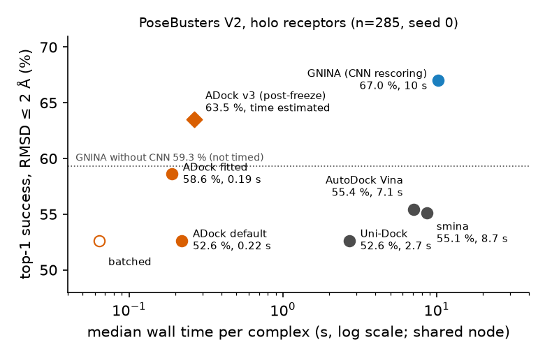

# ADock: fast physics-based docking, and an AlphaFold gap that physics cannot close

*Technical report, October 2026. AI-agent project (24 h). Results were checked by independent agents, not yet by
human experts. Full record: `docs/REPORT.md`. Figures: `scripts/make_summary_figures.py`.*

## 1. In brief

**ADock predicts how a small molecule binds in a protein pocket, quickly.** It takes a protein structure, a ligand and
the pocket location, and returns the ligand's 3D pose. It is a GPU reimplementation of the classical AutoDock Vina
approach with a refitted, interpretable scoring function. We then used it to ask why docking into AlphaFold models
fails.

- **Speed.** About 0.2 s per complex. That is 12× faster than Uni-Dock and about 50× faster than GNINA in the same
  timing run. One GPU node handles about 66 pockets per second.
- **Accuracy on experimental structures.** ADock is level with the established physics tools (Vina, smina) and with
  GNINA without its neural network. It is clearly below GNINA with neural-network rescoring (59 % vs 67 %).
- **The AlphaFold gap.**
  - On the same test complexes, success falls from 50 % to 11 % when the experimental receptor is replaced by its
    AlphaFold model. GNINA falls from 61 % to 17 %.
  - None of the 13 fixes we tried closes this gap.
  - "Oracle" experiments, which insert parts of the true pocket into the model, place the cause in sub-ångström errors
    of the pocket backbone and side chains together. They do not place it in side-chain rotamers or missing metals
    alone.
  - This diagnosis rests on validation data with wide confidence intervals.
- **Pre-registered claims.** All three pre-registered main claims failed after multiple-testing correction.

## 2. Problem, terms and test setup

**Docking.** Given a protein and a ligand, predict the ligand's bound 3D pose. We assume the pocket is known. It is
given as a 24 Å box around the residues that touch the true ligand, and every method gets the same box. A prediction
**succeeds** if the top-ranked pose is within 2 Å RMSD of the crystal pose (RMSD = root-mean-square distance between
matching ligand atoms, with symmetry taken into account).

**Receptor types.**
- **Holo / experimental:** the crystal structure solved with the ligand bound. Its pocket is already shaped for the
  ligand, so this is the easy case.
- **AlphaFold (AF):** the predicted structure of the same protein from the AlphaFold database. This is the realistic
  case at proteome scale, where most proteins have no experimental structure.

**Benchmarks.** Public sets, held out until a single final evaluation (seed 0 unless stated):

| test set | n | used for |
|---|---|---|
| PoseBusters V2 (Buttenschoen 2024) | 285 | accuracy and speed, experimental receptors |
| Runs N' Poses ∩ PLINDER, released after 2023-06-01 (Škrinjar 2025; Durairaj 2024) | 222 (178 with AFDB v4 model) | the same complexes with experimental and AF receptors |
| PoseBusters V2 with AFDB / ESMFold receptors (PoseBench, Morehead 2025) | 268 | secondary AF test |
| Runs N' Poses dimer-pocket set | 1080 | pockets formed by two chains |

The post-2023 cut keeps the test complexes out of the AlphaFold models' training data.

**How the AF gap was studied.** All diagnosis was done on a separate validation set of 125 post-2023 complexes with
AF models, never on the test sets. The set was split in two halves:
- choices were made on the **selection** half;
- the result was checked once on the **confirmation** half.

**Comparators.** AutoDock Vina, smina and Vinardo (classical physics scores); Uni-Dock (a GPU version of Vina);
GNINA 1.3 (Vina search plus a convolutional neural network that rescores poses, the strongest open docking tool;
McNutt 2025). Claims, thresholds and tests were written down before the test data were opened
(`config/preregistration.yaml`). A code guard logged every access to test data.

## 3. The method

**Step 1 — GPU search.** Many random starting poses are improved in parallel by Monte Carlo moves and gradient-based
minimisation (BFGS). This is the Vina algorithm (Trott & Olson 2010; Eberhardt 2021), rewritten so that each search
chain runs in one GPU warp (a group of 32 threads), with the scoring grid held on the GPU. The idea of batching many
searches per GPU kernel comes from Uni-Dock (Yu 2023). The same source also compiles for multi-core CPUs.
*Why:* proteome-scale docking needs well under a second per pocket, and Vina takes 5–20 s.
*Code:* `src/adock/` (kernels, `dock.py`).

**Step 2 — fitted scoring (18 weights).**
- *What:* the Vina energy terms are kept, and 8 interpretable terms are added: buried hydrophobic and hydrogen-bond
  contacts, charged hydrogen bonds, and metal–acceptor, ionic and polar–apolar contacts. With default weights the
  function equals Vina exactly.
- *Fit:* the weights are fitted so that crystal-like poses rank above decoys. The fit uses about 117,000 poses from
  training complexes released before the test sets.
- *Why:* when ADock failed, the crystal pose usually scored worse than a wrong pose, so the score was at fault, not
  the search (147 of 206 failures). The refit adds 6 points on PoseBusters (52.6 → 58.6 %).
- *Code:* `src/adock/fit/`; weights in `config/adock_fitted.json`.

A later variant, "v3", was set after the freeze and is exploratory. It adds more search and caps the repulsion term,
for +3.5 points averaged over seeds at 1.4× the cost.

## 4. Results on experimental receptors

**Fig. 1. Speed and accuracy on experimental receptors.** Each point is one method. Time is the median per complex
in one scripted pass over 50 complexes on a shared node; success is over all 285 complexes. ADock is an order of
magnitude faster than every comparator at Vina-level accuracy. GNINA's neural-network rescoring adds about 8 points
over physics-only scoring. The v3 time is estimated, not measured.

**Pre-registered claims** (seed 0; Holm correction over three claims):

| claim | result | verdict |
|---|---|---|
| C1: on AF receptors (n=178), ADock is at least as accurate as GNINA | 11.2 vs 18.0 % | fail |
| C2: faster than GNINA and Uni-Dock **and** not worse than them (margin 3 points) | 0.22 s vs 10.2 / 2.7 s; 52.6 vs 67.0 / 52.6 % | speed passes, accuracy fails |
| C3: fitted ADock not worse than the best physics comparator (GNINA without CNN, margin 5 points) | 58.6 vs 59.3 % | p 0.042, Holm 0.13: not significant |

In pockets formed by two different chains, ADock was not worse than GNINA (54.8 vs 43.5 %, exploratory).

## 5. The AlphaFold gap: what fails and why

**Size.** On the 222 post-2023 test complexes, moving from the experimental receptor to the AF model costs ADock 40
points (50.5 → 10.8 %) and GNINA 45 points (61.3 → 16.7 %). AF pockets are not crude: their backbone is a median
0.4–0.5 Å from the experimental one. The gap is therefore a question of small errors.

**Fig. 2. What closes the AlphaFold gap on validation data?** Each row is the change in success relative to docking
into the plain AF model. The dashed line marks the full gap (+18.6 points, experimental vs AF receptor). Samples
differ slightly between rows (n ≈ 107–125), and most arms were run with 2–3 seeds. Sources for every row are in
`docs/summary/af_gap_arms.csv`.

**(a) Thirteen attempted fixes.**
- **Make the receptor forgiving:** softer atoms or side chains, ligand-aware side-chain repacking, rotamer
  ensembles, ion placement. Gains were +0 to +3 (all confidence intervals include 0). The selection-half gains of
  +7 to +9 vanished on confirmation.
- **Change the score or ranking:** an AF-tolerant refit, consensus scoring, re-ranking, and a full force field
  (Amber14 with implicit solvent) refining the top poses. These gave −3 to +2.
- **Change the receptor:**
  - BioEmu2 ensembles were worse (−7 to −14). Their pockets were further from the truth than AF's (1.48 vs 0.89 Å).
  - Transplanting the pocket of a related experimental structure gave −2.8.
  - Boltz-2 co-folded receptors without the ligand gave −3.3.
  - Only co-folding *with the query ligand and a pocket constraint* helped: +8.3, with +6.0 on the confirmation half
    (not significant). It closes less than half the gap and needs the ligand and a deep-learning model.

**(b) Oracles show where the gap is.**
- Inserting the true side-chain angles, or adding the crystal metals and cofactors, recovers 0–6 points; none of
  these is significant.
- The true backbone alone gives +7 (not significant). Backbone and side chains together give +12 [4, 21].
- The gap thus lives in sub-ångström geometry of the whole pocket. This runs against the common expectation that
  side-chain rotamers are the main problem.

**Why physics cannot see past it.**
- *Failure types:* 53 % of AF failures are scoring failures, where the minimised crystal pose scores worse, by a
  median 2.3 kcal/mol, versus 0.4 in holo pockets. 39 % are receptor failures: the crystal pose is not even an energy
  minimum and drifts more than 2 Å. Only 8 % are search failures.
- *Force field:* even a full force field ranks the true pose first in only 25–40 % of AF pockets, against 42–52 % of
  experimental ones.
- *Ranking:* a correct pose is among the top 20 in 35–41 % of AF cases, but no feature we tried picks it out.

**Caveats.**
- Everything in this section is validation data (n ≈ 107–125) with wide intervals.
- Several arms report ranges or point values without intervals.
- The oracle and pocket-transfer analyses were run after the test evaluation, but on validation data only.
- An apparent +8 from the re-ranker was a benchmark artefact: it had learned that the true ligand sits at the box
  centre, and a 3 Å box shift turned the gain into −5. Fig. 2 shows the re-ranker without that feature.

**Side note: copying poses from earlier complexes.**
- If a complex of a similar protein and ligand released before the query exists, the ligand pose can be transferred
  directly (as in AlphaFill; Hekkelman 2023). This reached 23.6 % vs GNINA's 18.0 % on the AF test (p 0.077,
  exploratory).
- With close relatives excluded it fell to 11.8 %, and co-folding (Boltz-2) showed the same dependence on
  similarity. Both reuse known complexes rather than fixing physics, so they do not change the conclusion above.

## 6. Main insights

**About the science**

1. **AlphaFold pockets are close but not close enough.** Errors below 1 Å in backbone and side chains together
   cost physics docking most of its accuracy. Fixing side chains alone, adding metals, softening or sampling more
   does not recover it.
2. **The failure is in the energy landscape, not in the search.** In AF pockets the true pose often scores worse
   than wrong poses, or is not a minimum at all. A full force field is misled about as much as Vina.
3. **Generated conformations did not help.** BioEmu2 samples and homolog pockets were not closer to the true pocket
   than AF itself. Only ligand-aware co-folding moved the pocket usefully, and only partly.
4. **Scoring, not search, limits classical docking even on experimental structures.** A modest, interpretable refit
   gives +6 points, mostly through metal and desolvation terms.

**About research practice**

1. **Selection optimism is large.** Gains of 6–9 points on the selection half shrank to 0–3 points (not
   significant) on the confirmation half in nearly every arm. Only confirmation numbers should be believed.
2. **Oracles first.** Testing the best case first, for example perfect side chains, ruled out several planned
   approaches before they were built, and located the gap.
3. **Check gains against how the benchmark was built.** The re-ranker's "gain" came from the box definition.

## 7. How the work got its shape (turning points)

1. **Design review (hour 1).** Four reviewer agents moved the AF test to post-2023 complexes, fixed one box rule for
   all methods, and pre-registered the claims.
2. **Measuring the gap first (hour 5).** On validation, GNINA fell from 44 to 17 % on AF receptors. The gap was real
   and large, so it became the main question (`docs/reports/af_gate.md`).
3. **Engine parity (hour 5).** The GPU engine matched Vina at about 40× lower time, but most failures were scoring
   failures. This led to Step 2 (`engine_v2.md`).
4. **The confirmation split (hour 6).** The fitted score's +6–8 on the selection half became +2.8 on confirmation.
   From then on, only confirmation numbers counted (`scoring_fit.md`).
5. **Oracles redirect the search (hour 7).** True side-chain angles gave no gain, against the expectation from the
   literature. The receptor-softening and repacking arms then failed as predicted (`afmode.md`).
6. **A false positive caught (before the freeze).** The re-ranker's +8 disappeared under box shifts (`rerank.md`).
7. **Last arms and the full oracle (hours 8–20).** Force field, BioEmu2, pocket transfer and co-folded receptors
   failed or helped only partly. The full-pocket oracle (+12 to +22) quantified what an accurate pocket would be
   worth (`induced_fit.md`, `bioemu_ensemble.md`, `pocket_transfer.md`, `cofold_msa.md`).

## 8. Limitations and when not to use ADock

- **Pocket known.** The pocket must be given; predicted pockets were not tested.
- **AlphaFold receptors.** Expect about 11 % top-1 success on AF models of new proteins. GNINA reaches about 17–18 %;
  no tested method is reliable there.
- **Highest accuracy.** On experimental structures GNINA's rescoring is still about 8 points better.
- **Timing.** All timings come from a shared node, so treat them as upper bounds. The throughput figure is a
  projection, not a measurement on the full AlphaFold database.
- **Reproducibility details.** Engine changes after the fit moved validation results by a few complexes, and results
  depend slightly on batch composition.

**Credits.** Vina, Vinardo and smina (scoring and search); Uni-Dock (GPU batching); GNINA (comparator); OpenMM and
Amber (force field); BioEmu and Boltz-2 (structure models); AlphaFill (ligand transfer); PoseBusters, Runs N' Poses,
PLINDER and PoseBench (benchmarks). References: `docs/LITERATURE.md`.
